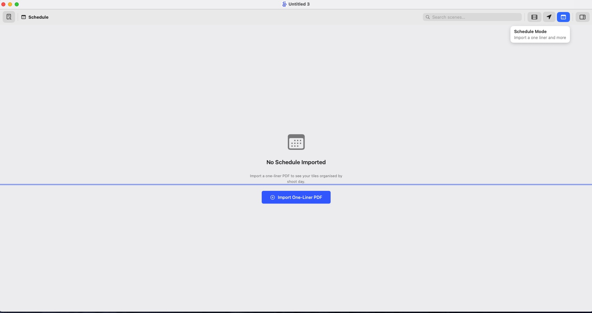
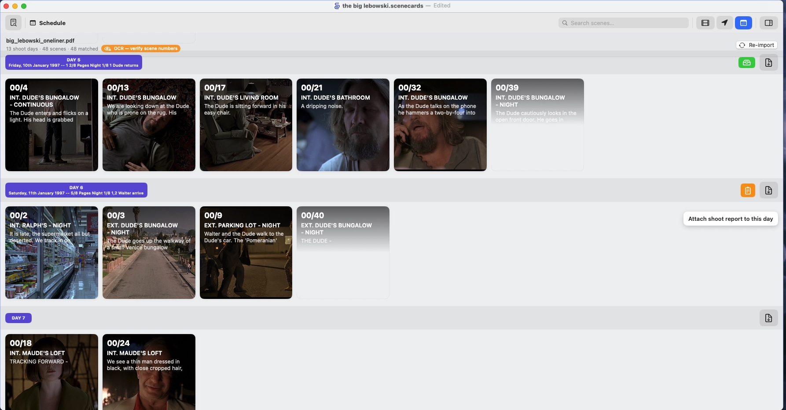

<!--
TODO — still open for this chapter:
  1. Screenshots still needed: a populated day section showing report
     badges on the day header, the card context menu in Schedule mode.
  2. RESOLVED — iPadOS has exactly two one-liner import entry points:
     (a) the empty-state "Import One-Liner PDF" button, and
     (b) the "Import New Schedule" button in the schedule top bar.
     The IOSNavToolbar overflow (⋯) menu has NO one-liner option —
     only script import, images, photos, shoot reports, and print.
     §9.2.1 and §9.2.2 are accurate as written.
  3. RESOLVED — a scene that appears in two shoot days in the one-liner
     renders as a full card in BOTH days (tileGrid runs matchedTile
     independently per day; no deduplication guard). This is the
     intended behaviour for scenes split across multiple shoot days.
     The second occurrence is not a placeholder and not silently dropped.
     The Unmatched section correctly excludes it. Shift-select
     deduplicates via orderedTileIDs so the tile counts once in a range.
     §9.4.2 and §9.8 have been updated to document this.
-->

# Chapter 9 — Scheduling

**Schedule mode** reorganises the wall into shoot days drawn from an
imported one-liner PDF. Instead of script order, you see each day's
scenes as a grid of cards — with crew call, total pages and report
badges in the day header. Call sheets, sound, camera and continuity
reports can all be attached per day (§9.6), and a tidy **Unmatched**
section at the bottom catches any cards not yet accounted for.

This chapter covers switching into Schedule mode, importing and
re-importing the one-liner, how cards are matched to schedule entries,
moving cards between days, multi-select, and what the various badge
colours mean. Attaching sound, camera and continuity reports to a day
is in §10.

## 9.1 Switching to Schedule Mode

Three routes reach Schedule mode:

| Route | Action |
|---|---|
| Toolbar | Tap or click the **Schedule** segment |
| Keyboard | `⌘⇧3` |
| Menu | `View → Schedule` |

`⌘⇧1` and `⌘⇧2` return to **Scenes** and **Locations** respectively.

Without an imported one-liner, Schedule mode shows an empty state with
a single **Import One-Liner PDF** button. Once a schedule is loaded,
the full day-by-day view appears.

## 9.2 Importing a One-Liner

The one-liner is the shoot schedule — a PDF strip board that lists
scenes grouped by shoot day, with crew call times and page counts.
Scene Cards reads the PDF and builds the day structure automatically.

### 9.2.1 First import

1. Switch to Schedule mode.
2. Tap or click **Import One-Liner PDF** in the centre of the screen.
3. Select the PDF from the file picker and click **Open**.

Scene Cards scans the first few pages of the PDF and auto-detects the
scene number format — dot (`2.14`), dash (`2-14`), slash (`2/14`), or
film (bare numbers like `14`, `103A`). In most cases the detection is
confident and parsing begins immediately.

If the format is ambiguous — for example, the PDF contains a similar
number of dot-separated and slash-separated patterns — a **Scene Number
Format** picker appears. Each option shows the number of matching
patterns found in the PDF (e.g. "8 found"), so you can make an informed
choice without going back to open the file. Select the row for the
separator your schedule uses between episode and scene number — or
**Auto-detect** to let Scene Cards make a best guess — then click
**Import**.

Scene Cards then parses the full PDF, matches each scene number against
the cards on your wall, and populates the schedule. A progress indicator
appears while parsing runs.

### 9.2.2 Importing a second schedule — Merge or Replace

When a schedule is already loaded and you click **Import New Schedule**
in the top bar, a dialog asks how to handle the incoming schedule:

| Option | What it does |
|---|---|
| **Merge** | Days with matching day numbers are updated from the new PDF. Days that exist only in the new PDF are added. Days that exist only in the current schedule are left unchanged. All attached shoot reports survive. |
| **Replace** | The current schedule is discarded entirely and replaced with the new PDF. Manual day assignments are lost. |
| **Cancel** | Nothing changes. |

Use **Merge** when a revised strip board has been issued for some shoot
days and you want to carry forward reports already attached to unchanged
days. Use **Replace** when the entire schedule has been restructured.

> ⓘ **Note** — manual day assignments (the orange-badge overrides, §9.5)
> are stored by card, not by day. Merge preserves them; Replace removes
> them along with the schedule.

### 9.2.3 OCR warning

When the one-liner is a scanned image PDF rather than a text PDF, Scene
Cards falls back to OCR to extract the scene numbers. An orange
**OCR — verify scene numbers** badge appears in the top bar. Check the
Unmatched section (§9.4.3) after import and manually assign any cards
that landed incorrectly.

> ✱ **Tip** — if a schedule imports badly (scenes missing, or scenes
> appearing on the wrong day), 🍎 **File → Export Schedule Import
> Diagnostic…** writes out exactly what the parser read from the PDF,
> including the OCR text. Sending that file alongside a description of
> what you expected makes the problem reproducible without needing the
> schedule itself re-run. A long schedule takes a few minutes to export
> because it re-runs OCR; the progress toast counts the pages.
>
> The same report also covers the cast side, so it's the thing to send if
> a character is missing from Cast mode: it lists the cast list it read
> from page 1, the cast numbers it found for each scene, and the scenes
> where it found none — those last ones are worth checking against the
> PDF, since a blank cast column is normal and looks the same in the
> report as a column it failed to read.

### 9.2.4 One-liners on your cards

Each scene on a one-liner carries a short description of what happens in
it ("LENA checks her appearance before heading to the front door."). It's
written by the AD, so it's usually a truer summary of the scene than the
first action line taken from the script. When you import a schedule, Scene
Cards copies each scene's one-liner onto its matching card, replacing the
card's **Action** text (§6.4).

- **Every way a schedule comes in** — a first import, Merge, Replace, and
  importing a schedule from another project (§12) all update the cards. On
  Merge, only the scenes in the newly imported PDF are updated.
- **Blank one-liners are skipped** — a scene with no description on the
  schedule keeps its current Action text.
- **Split scenes** — a scene shot across several days (`1.31p1/2`,
  `1.31p2/2`) takes the one-liner from its first appearance.
- **Hand-typed Action text is replaced too** — the schedule's one-liner
  wins. Undo straight after the import puts it back.
- **Text cut off in the PDF stays cut off** — some schedules truncate long
  descriptions in the printed column ("Maude descends …"). Scene Cards
  copies them as printed.
- **Re-importing a script doesn't undo it** — a script re-import only fills
  Action text on cards where it's empty, so the schedule's one-liners stay.
- **Call sheets don't change Action text** — a call sheet's scene
  descriptions are normally copied from the schedule, so importing one
  (§10) leaves the cards as they are.

Scene Cards finds the description by its position on the page, so it works
whether the schedule prints it in its own column on the scene's row or on
the line beneath the set name. It needs the PDF's text layer: a schedule
that is only a scanned image (§9.2.3) doesn't get one-liners, and its cards
keep their existing Action text.

> ⓘ **Note** — a schedule imported before version 2.1.7 was saved without
> one-liners. Import it again (Replace is fine) to fill them in.

## 9.3 The Schedule Top Bar

When a schedule is loaded, a persistent bar appears at the top of
Schedule mode showing:

- **Source filename** — the name of the imported PDF.
- **Day / scene / match counts** — e.g. `12 shoot days · 87 scenes · 84 matched`.
- **OCR badge** — orange, when OCR was used (§9.2.3).
- **Import New Schedule** button — imports another PDF, offering Merge or Replace (§9.2.2).

## 9.4 Reading the Day View

### 9.4.1 Day header

Each shoot day opens with an indigo **DAY N** badge. The badge also
shows the date and crew call when the one-liner carries them. To the right:

| Element | Meaning |
|---|---|
| 🟢 Cast badge | Sorted list of cast numbers for the day (green, when the one-liner includes cast columns). Tap it to see each number resolved to a name — see below |
| 🗒 Total pages | Page count for the day |
| ⚠ N unmatched | Scenes in the one-liner with no matching card |
| Report badges | Colour-coded icons for attached reports (§9.6) |
| ↓doc button | Opens the **Attach Report** menu for this day (§10) |

**Cast numbers, named.** Every one-liner schedule's first page is a "CAST
MEMBERS" list — a cast number next to each character's name. Scene Cards
parses that page automatically on import and remembers it with the
document, so tapping the cast badge on any day shows each number next to
the name it resolves to, instead of just the bare numbers. This is a
best-effort read of the page, the same way OCR schedule import is (§9.2.3)
— most names come through correctly, but on a dense, multi-column cast
list a few can end up attached to the wrong number. Worth a glance the
first time you use it; a wrong name is easy to fix by re-importing a
corrected schedule, or by using Cast mode's Merge/Hide tools (§3.2) if
it's already been pulled into a Cast-mode group. If a schedule was
imported before this existed, or its first page isn't a recognisable
cast list, the badge still works — it just shows numbers with no names
until you re-import that schedule PDF. Cast numbers in the 1-100 range
(the main/speaking-cast band on a typical UK schedule) also feed **Cast
mode** (§3.2) directly, so a character who's in scenes but never speaks
can still get their own group there without being added by hand.

> ⓘ **Note** — putting cast numbers against *individual scenes* (rather
> than against the day as a whole) is done by reading the schedule's cast
> column by its position on the page. That needs a PDF containing real
> text. If your schedule is a **scan** — an image of a page, which Scene
> Cards has to read with OCR — the day badge still names its cast, but
> per-scene cast numbers aren't filled in and Cast mode falls back to
> characters detected from dialogue. A schedule exported straight from
> Movie Magic, Yamdu, Scenechronize or similar is normally real text; one
> that's been printed and scanned, or photographed, is not.

### 9.4.2 Scene cards

Cards that matched a schedule entry appear as full tiles — still image
(if one has been attached), scene number, heading and action.
They behave the same as on the wall: tap to select, double-tap to open
the inspector.

If a scene number appears in **more than one shoot day** in the
one-liner (a long scene split across two days), the card appears as a
full tile in each of those days — it is not deduplicated. This is the
intended behaviour; the same scene genuinely belongs to both days.

Small badges in the top-right corner of a card:

| Badge | Meaning |
|---|---|
| 🖐 Orange hand | Card has been manually assigned to this day (§9.5) |
| 〰 Cyan waveform | Manual assignment AND sound report data exists for this day |
| ⬤ Coloured dot | Revision colour from the script (§5.5) |

### 9.4.3 Placeholder cards

Scenes from the one-liner that have **no matching card** on the wall
appear as placeholder tiles — dashed border, greyed text, orange **?**
badge. They carry the scene number, set and one-liner description from
the PDF.

Placeholders are read-only. To turn a placeholder into a real card,
import the script and make sure the scene number matches, or manually
create a card and assign it to the day (§9.5).

### 9.4.4 Unmatched tiles section

Cards on the wall that appear in **no** shoot day — neither by schedule
match nor by manual assignment — collect in an **Unmatched Tiles** strip
at the bottom of the schedule. The orange header shows the count.

Assign an unmatched card to a day by right-clicking it (🍎 macOS) or
long-pressing it (📐 iPadOS) and choosing a shoot day from the menu, or
by dragging it onto a day section (§9.5.2).

## 9.5 Moving Cards Between Days

### 9.5.1 Context menu

Right-click a card (🍎 macOS) or long-press a card (📐 iPadOS) to open
the context menu:

| Option | What it does |
|---|---|
| **Move This Tile to Shoot Day…** | Reassigns this one card to the chosen day |
| **Move This and All Below to Shoot Day…** | Reassigns this card and every card below it in the current day's order |
| **Clear Manual Assignment** | Removes the override; card reverts to schedule matching |
| **Remove from Schedule** | Removes this scene entry from the day entirely (card stays on wall) |

**Move N Selected Tiles to Shoot Day…** replaces the single-tile option
when multiple cards are selected (§9.5.4).

### 9.5.2 Drag to a day

Drag any card and drop it onto a different day section. The day
highlights in blue while you hold the card over it. Release to
assign. You can drag a multi-selection this way — all selected cards
move together.

### 9.5.3 Clear a manual assignment

A manually assigned card stays on the chosen day even if a new
one-liner is imported that would put it elsewhere. To revert to
schedule-driven placement, right-click → **Clear Manual Assignment**.

### 9.5.4 Multi-select and bulk move

To move several cards at once:

**🍎 macOS:**
- **⌘-click** individual cards to toggle them.
- **Shift-click** to extend the selection to a range.

**📐 iPadOS:**
- Tap one card to select it, then tap others to add them.

A selection bar appears at the top of the schedule showing the count
and a **Move to Shoot Day…** menu. Choose a day to move all selected
cards in one step. The selection bar also has an **✕** button to
deselect all.

> ✱ **Tip** — use **Move This and All Below to Shoot Day…** from the
> context menu to quickly slide a block of scenes from one day to
> another without selecting them individually.

## 9.6 Report Badges

Each day header can show up to one badge per report type. Badges are
added when you attach a shoot report (§10); they give a quick visual
status of what has been imported for each day.

| Badge | Report type |
|---|---|
| 🩵 Teal | Sound |
| 🔵 Indigo | Camera |
| 🟠 Orange | Continuity |
| 🟣 Purple | Call Sheet |
| 🟢 Green | Essentials |

**Tap or click a badge** to open the attached file. On 📐 iPadOS a
QuickLook preview opens; on 🍎 macOS the file opens in the system
default app.

**Right-click a badge** for a context menu with **Open** and
**Remove** options. Removing a badge deletes the report attachment
record from the document (the file inside the package is not deleted).

## 9.7 Searching in Schedule Mode

The search bar filters the day view in real time. Matching is across:

- Scene number (e.g. `14`, `14b`, `1/14`, `01-14`)
- Set description
- One-liner text
- Card heading and action text

Type `1/14` or `01-14` to find scene 14 in episode 1 specifically.
Days that have no matching scenes are hidden while the search is active.
The **Unmatched** section is also filtered.

Clear the search to return to the full schedule view.

## 9.8 How Matching Works

Scene Cards matches each schedule entry to a card using normalised
scene numbers:

1. **TV format** — `ep-scene` e.g. `01-14`, `1-14a`. Matches a card
   whose `sceneDisplay` normalises to the same string.
2. **Film format** — bare scene number e.g. `14`, `14A`. Matches any
   card with that scene number across all episodes.

Normalisation strips leading zeros, converts separators (`/`, `.`) to
dashes, and removes part labels (`pt1`, `pt2`). The match is
case-insensitive.

A card that has been **manually assigned** to a day (§9.5) always
appears on that day regardless of what the one-liner says. In the day
where the schedule originally placed it, the slot shows as a placeholder
until the manual assignment is cleared.

A scene that appears in **two shoot days** in the one-liner (split
scene) renders as a full card in both days with no manual action needed.
The Unmatched section at the bottom correctly excludes it.

## 9.9 Persistence

The imported schedule and all manual day assignments are saved inside
the document:

- The `OneLinerSchedule` (shoot days, scene entries, date strings) is
  stored in `payload.json` alongside the wall state.
- Manual assignments (`manualScheduleDay`) are stored in the wall state
  and survive script re-imports (§5.1.2).
- Report attachment records are stored in the wall state; the report
  files themselves live in `Media/reports/Day_NN_DDMMYY/{type}/` (§10.7).

Opening the document on another machine restores the full schedule view
without re-importing the PDF.

## 9.10 Where to Go Next

- **Attach sound, camera and continuity reports** — see §10 *Shoot
  Reports*.
- **Print the wall** — Schedule mode is not currently printable; use
  Scenes mode for printing. See §11.
- **Multi-episode scene numbers** — see §13 *Multi-Episode*.
- **Switching between wall modes** — keyboard shortcuts in §16.
